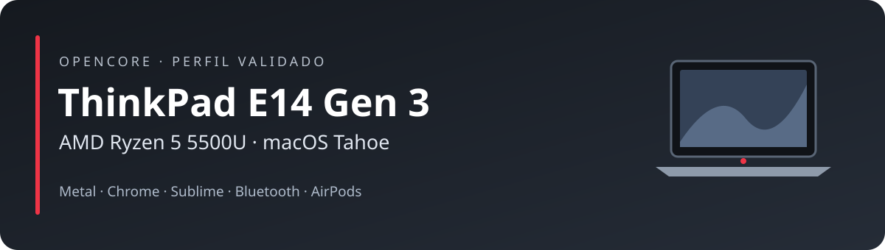
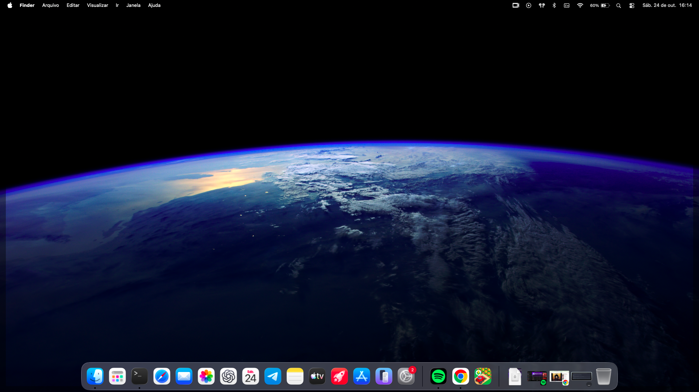

<p align="center"></p>

<p align="center">
  
  
  
  
</p>

# ThinkPad E14 Gen 3 AMD · macOS Tahoe

Configuração de referência do **Lenovo ThinkPad E14 Gen 3 AMD**, com Ryzen 5 5500U,
macOS **26.7.1 / 25G241** e OpenCore **1.0.8**. Validada em uso real em **24/10/2026**.

Este projeto documenta a EFI funcional e as correções que resolveram a corrupção
gráfica ao abrir Sublime Text/Chrome e a inicialização do Bluetooth Realtek.
As fontes das adaptações locais e os testes estão incluídos.

**O que foi confirmado:** Sublime e Chrome abrindo normalmente, YouTube em 1080p60
e tela cheia fluido, dispositivo Metal disponível e AirPods conectados reproduzindo música.

## O ThinkPad em uso



*Captura feita no próprio notebook em 24/10/2026, após as correções de gráficos
e Bluetooth. Os resultados funcionais e seus limites estão registrados abaixo.*

## Hardware de referência

| Componente | Configuração |
| --- | --- |
| Notebook | Lenovo ThinkPad E14 Gen 3 AMD, tipo 20YD |
| Processador | AMD Ryzen 5 5500U, 6 núcleos / 12 threads |
| Gráficos | Radeon Vega integrada, PCI `1002:164c` |
| Memória | 16 GB; 4 GB de memória gráfica anunciados pelo driver |
| SSD | Samsung NVMe, aproximadamente 512 GB |
| Wi-Fi | Realtek RTL8852AE, PCI `10ec:8852` |
| Bluetooth | Realtek USB `0bda:4852`, firmware `rtl8852au` |
| Codec de áudio | Realtek ALC257, layout 11 |
| SMBIOS do perfil | `iMac20,1` |

Veja [hardware e estado de validação](docs/hardware-e-status.md) antes de usar a EFI em outra unidade.

## Resultados

| Função | Resultado desta validação |
| --- | --- |
| Boot pelo SSD com OpenCore | Confirmado |
| Metal / IOAccelerator | Dispositivo Metal e contexto GPU observados |
| Sublime Text 4 | Abertura, digitação e movimento/redimensionamento sem corrupção |
| Google Chrome | Abertura, navegação e rolagem normais |
| YouTube | 1080p60 e tela cheia fluidos no teste do usuário |
| H.264 / HEVC | Capacidade de decodificação por hardware anunciada pela API |
| Bluetooth Realtek | Ligado, endereço válido e transporte USB |
| AirPods | Pareamento, conexão e reprodução de música confirmados |
| Wi-Fi | Perfil inclui AirPort_RTW89 para RTL8852AE |
| Áudio integrado | Perfil ALC257 / AppleALC / SimpleHDA; ver [áudio e rede](docs/audio-e-rede.md) |

Microfone dos AirPods, repouso/retomada, HDMI e estabilidade prolongada não foram
validados nesta rodada. VP9 e AV1 não anunciaram decodificação por hardware.
O teste fluido do YouTube não mede, por si só, qual mecanismo decodificou aquele vídeo.

## Conteúdo

```text
EFI/                 Perfil funcional de referência, com SMBIOS anonimizado
docs/                Hardware, uso, gráficos, USB/Bluetooth e resultados
profiles/            Versões e hashes do perfil publicado
source/NootedRed/    Fonte completa da adaptação local 0.9.2
source/RealtekBluetoothFirmware/  Fonte upstream correspondente ao loader 1.0.2
source/dependencies/ Lilu e MacKernelSDK nas revisões usadas na compilação
scripts/             Preparação local, validação, compilação e diagnósticos
bin/                 Helpers de consulta Metal e leitura da página OpenGL
```

O histórico de conversa, fotos pessoais, dumps brutos, ferramentas de análise,
instaladores do macOS e backups privados não fazem parte desta publicação.

## Começar

1. Leia [preparação e uso da EFI](docs/preparacao-e-uso.md).
2. Confira o hardware e o build exato do macOS.
3. Gere **sua própria identidade SMBIOS** e crie uma cópia em `EFI-private/`.
4. Valide a configuração com `ocvalidate` **1.0.8**.
5. Preserve uma forma de iniciar com a EFI anterior antes de testar a cópia.

**A EFI pública tem serial, MLB, UUID e ROM removidos.** Personalize a cópia local
antes do uso. Os scripts publicados não formatam discos nem gravam a EFI ativa.
Os instaladores usados durante a investigação eram vinculados ao SSD do laboratório
e foram substituídos aqui por instruções e ferramentas portáveis.

```bash
python3 scripts/validar-repositorio.py
python3 scripts/preparar-efi-local.py --identity /caminho/identidade.json
```

## As correções

### Gráficos

O perfil utiliza **NootedRed local 0.9.2**, baseado no fork de pesquisa de
`steve12311/NootedRed`. A adaptação inclui assinatura das páginas modificadas e
um patch OpenGL de seis bytes, com comparação integral da página original,
para o driver do build testado. Não é uma release oficial do NootedRed.

[Explicação, limites e reprodução](docs/graficos.md) · [fontes e compilação](docs/fontes-e-compilacao.md)

### USB e Bluetooth

O mapa Apple associado ao SMBIOS ocultava a porta do rádio. O perfil usa
`XHC1 → XHB1` e um mapa das portas internas 3/4. O firmware Realtek é carregado
pelo loader 1.0.2; BlueToolFixup 2.7.2 e duas variáveis NVRAM permitem selecionar
o backend HCI genérico `THIRD_PARTY_DONGLE`.

O nome `Bluetooth Radio` é esperado. A tentativa de forçar o nome Apple foi
descartada porque selecionava um backend Broadcom incompatível.

[Diagnóstico e configuração exata](docs/bluetooth-usb.md)

## Diagnósticos

Execute no Terminal normal do macOS:

```bash
bash scripts/coletar-bluetooth.command
bash scripts/verificar-metal-codecs.command
bash scripts/verificar-nootedred-gl.command
```

Os resultados ficam em `diagnosticos/`, ignorado pelo Git. Uma consulta vazia em
um executor restrito não substitui a consulta no Terminal nem um teste real do aplicativo.

## Documentação

- [Hardware e estado de validação](docs/hardware-e-status.md)
- [Preparação e uso](docs/preparacao-e-uso.md)
- [Gráficos: assinatura de páginas e OpenGL](docs/graficos.md)
- [Bluetooth e mapa USB](docs/bluetooth-usb.md)
- [Áudio e rede](docs/audio-e-rede.md)
- [Fontes e compilação](docs/fontes-e-compilacao.md)
- [Validação e resultados](docs/validacao.md)
- [Créditos e licenças](THIRD_PARTY_NOTICES.md)
- [Histórico das alterações](CHANGELOG.md)

## Créditos

ChefKiss / NootedRed, steve12311, Acidanthera, thegwchr, FranciumOS-org,
laobamac, OpenCore Legacy Patcher e os demais autores dos componentes listados
em [THIRD_PARTY_NOTICES.md](THIRD_PARTY_NOTICES.md).

A documentação e as adaptações deste perfil foram organizadas por **mkdev00x**.
REA e Ghidra foram usados na investigação; os limites entre análise estática,
consultas de capacidade e testes reais estão registrados na documentação.
